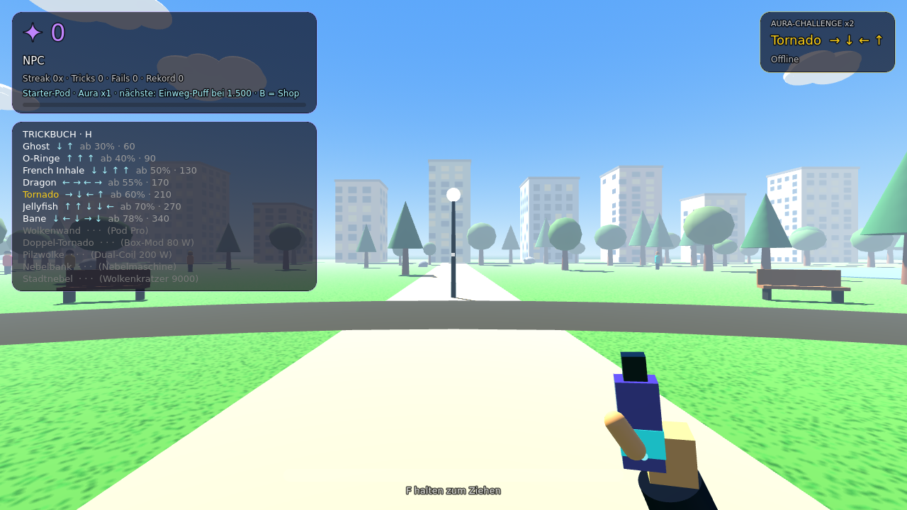
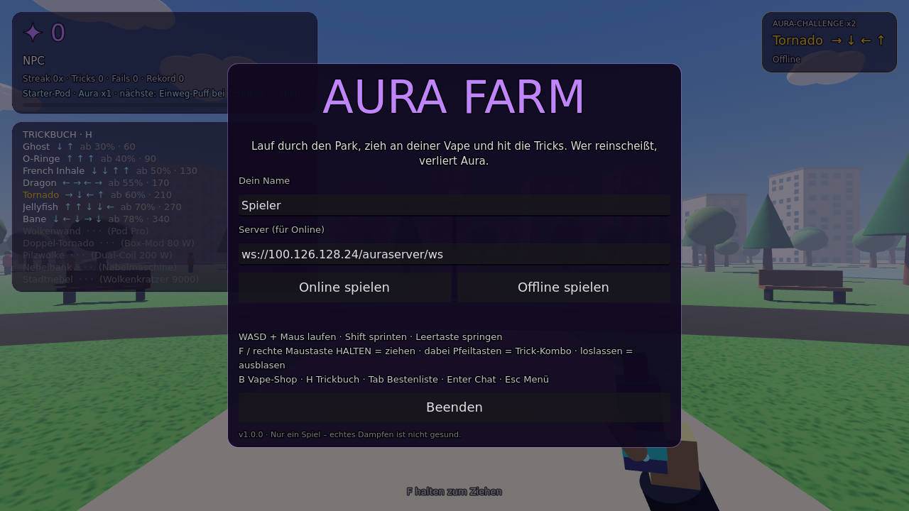
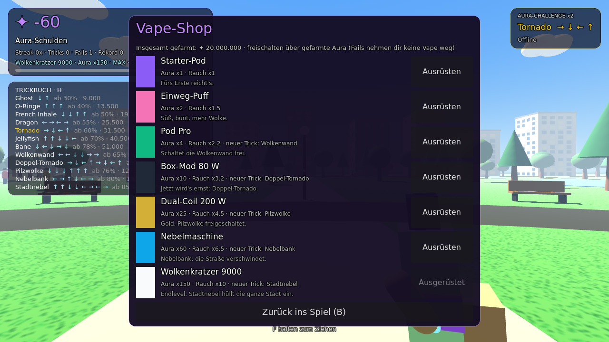

# 💨 Aura Farm

3D-Ego-Spiel: Lauf durch den Park, zieh an deiner Vape und hit Tricks (O-Ringe, Ghost, Tornado …).
Gute Tricks bringen **Aura**, wer reinscheißt, verliert sie. Mit Aura schaltest du bessere Vapes frei,
bis zum **Wolkenkratzer 9000**, der mit dem Trick *Stadtnebel* die ganze Stadt in Rauch hüllt.
Mit **Multiplayer**: Mitspieler, ihre Tricks und eine gemeinsame Bestenliste.

> Nur ein Spiel. Echtes Dampfen ist nicht gesund.



| Menü | Vape-Shop |
| --- | --- |
|  |  |

| Plattform | Datei | Installation |
| --- | --- | --- |
| **Windows** | `AuraFarm-…-windows-x86_64.zip` | entpacken, `AuraFarm.exe` starten |
| **Linux** | `AuraFarm-…-linux-x86_64.tar.gz` | entpacken, `./AuraFarm.x86_64` |
| **Android** | `AuraFarm-…-android-arm64.apk` | APK öffnen, „unbekannte Quellen“ erlauben |
| **iPhone** | `AuraFarm-…-ios.ipa` | per **AltStore** sideloaden (siehe unten) |
| **Web** | `AuraFarm-…-web.zip` | auf einen Webserver legen |

## Steuerung

**PC:** WASD + Maus laufen · Shift sprinten · Leertaste springen · **F oder rechte Maustaste halten** = ziehen,
dabei **Pfeiltasten** = Trick-Kombo, loslassen = ausblasen · **B** Vape-Shop · **H** Trickbuch · **Tab** Bestenliste · **Enter** Chat · **Esc** Menü

**Handy:** linker Daumen = Joystick, rechts wischen = umschauen, **ZIEHEN** halten, Pfeil-Kreuz für Kombos, oben Shop/Tricks/Liste/Menü.

## Aufbau

```
game/      Godot 4.3 (GDScript, Compatibility-Renderer)
  scripts/main.gd    Welt, Spieler, Tricks, Vapes, Shop, UI, Touch, Netzwerk, Selbsttest
  scripts/smoke.gd   eigenes Rauch-Partikelsystem (MultiMesh, bis 2400 Partikel)
  scripts/net.gd     WebSocket-Client
  scripts/sfx.gd     Sounds werden im Code erzeugt (keine Audiodateien)
server/    Multiplayer-Server: Node.js + ws, Statusseite, Bestenliste, Tests
.forgejo/workflows/build.yml   CI/CD (Forgejo Actions)
.github/workflows/ios.yml      iPhone-Build auf GitHub macOS-Runnern (für AltStore)
```

## Multiplayer-Server

Ein einziger HTTP-Port, läuft wie eine normale Website:

| Pfad | Zweck |
| --- | --- |
| `/` | Statusseite: wer ist online, Bestenliste |
| `/api/status` | dasselbe als JSON |
| `/healthz` | Health-Check |
| `/ws` | WebSocket fürs Spiel |

```bash
cd server && npm ci && npm start          # Port aus $PORT, Standard 8080
docker build -t aura-farm-server server && docker run -p 8080:8080 -v aura:/data aura-farm-server
```

**Kostenlos hosten:** Jeder Dienst, der Node.js oder ein Dockerfile mit WebSockets ausführt, funktioniert,
z. B. Render (Free Web Service, Root-Verzeichnis `server`), Koyeb, Fly.io oder Railway. Im Spiel
trägst du dann `wss://<deine-app>.onrender.com/ws` als Server ein. Bei Gratis-Hostern schlafen Server
oft nach Inaktivität ein, die erste Verbindung dauert dann ein paar Sekunden.

### Protokoll (JSON über WebSocket)

| Richtung | Nachricht |
| --- | --- |
| Client → Server | `hello {name, ver}` · `state {p:[x,y,z], yaw, vape, aura, farmed}` (10×/s) · `trick {id, st, p, dir}` · `chat {msg}` · `ping {ts}` |
| Server → Client | `welcome {id, name, players, board}` · `join` · `leave {id}` · `states {list}` (10×/s) · `trick {from, id, st, p, dir, vape}` · `board {top}` · `chat {name, msg}` · `pong` · `error {msg}` |

Der Server prüft und begrenzt alle Werte (Namen, Koordinaten, Trick-IDs, ~40 Nachrichten/s, 4 KB pro Nachricht).

## CI/CD (Forgejo Actions)

Jeder Push:
1. **Server-Tests** (`node --test`): zwei echte WebSocket-Clients, Tricks, Chat, Bestenliste, kaputte Eingaben
2. **Multiplayer-Test**: das Godot-Spiel (headless) verbindet sich mit dem echten Server
3. **Selbsttest** im Spiel: Tricks, Fails, Husten, Vape-Freischaltung, Stadtnebel, Partikel
4. **Builds**: Windows, Linux, Web, Android und iOS-Xcode-Projekt → `/builds/aura-farm/<datum>_<sha>/` und `latest`

Tag `v*` (z. B. `git tag v1.0.1 && git push --tags`) erzeugt zusätzlich ein **Forgejo-Release** mit allen Dateien.

## iPhone (AltStore)

iOS-Apps lassen sich nur auf einem Mac kompilieren. Deshalb baut `.github/workflows/ios.yml` die `.ipa`
auf den kostenlosen macOS-Runnern von GitHub Actions, **unsigniert**. AltStore signiert sie beim
Installieren mit deiner Apple-ID. Die `.ipa` aus dem Release herunterladen, in AltStore unter
„My Apps“ → „+“ auswählen. Kostenlose Apple-IDs müssen die App alle 7 Tage auffrischen.

## Lokal entwickeln

Godot 4.3 öffnen → `game/project.godot` importieren → F5.
Selbsttest: `godot --headless --path game -- --selftest [--server=ws://127.0.0.1:8080/ws]`
